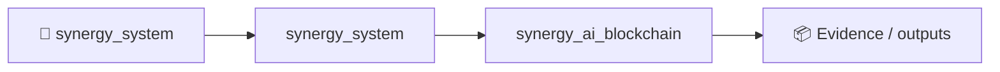

# SYNERGY AI Blockchain — PQ-EVM + NEXUS

Experimental consensus/execution core for the SYNERGY post-quantum EVM architecture.

## v1 implemented in this branch

- EVM-compatible system-precompile surface;
- native PQ authorization policies: `ONLINE`, `MAX`, `PQ_ONLY`;
- ML-DSA-87 and SLH-DSA-SHAKE-256s verifier precompile ABIs;
- deterministic fixed-point NEXUS graph kernel callable from every EVM context;
- frozen model-root / activation-block consensus model;
- Bitcoin / Ethereum / Solana legacy-identity migration binding;
- native Solidity `PQSmartAccount` facade;
- fail-closed security and migration invariants.

## NEXUS provenance

The current consensus profile points to NEXUS V18 research in `Shtenco/synergy_agi_olga`.
The reported V18 source checkpoint SHA-256 is:

`74433965c8193b6f75b42c197a4394bb14e37f2ef0ea0c7eb8b826e46c65c4e4`

The PyTorch checkpoint itself is **not** executed inside consensus. Production activation requires a deterministic quantized integer artifact, canonical test vectors and a frozen model root.

## Cryptographic rule

SYNERGY does not invent replacements for standardized PQ cryptography. Production nodes must use reviewed standards-conformant implementations for ML-DSA / SLH-DSA / ML-KEM. The repository defines consensus policy, deterministic execution interfaces and migration rules.

## Repository map

- `src/pq.rs` — hybrid/PQ authorization policies;
- `src/nexus.rs` — deterministic Q16.16 NEXUS consensus reference kernel;
- `src/consensus.rs` — reserved precompiles, gas and activation model;
- `src/migration.rs` — BTC/ETH/SOL → independent PQ identity binding;
- `contracts/` — Solidity ABI/facades for the PQ-EVM;
- `docs/ARCHITECTURE.md` — full architecture;
- `docs/SECURITY.md` — threat model and non-negotiable invariants.

## Local verification

The Rust reference core intentionally has no external dependencies:

```bash
cargo test
```

## Status

Research / integration branch. Not audited. Do not use it to custody real assets until the production PQ provider, EVM-client integration, cross-client vectors, light clients, bridge proofs and independent cryptographic audit are complete.


<!-- SYNERGY-FEDERATION-PASSPORT:START -->
---

## 🧭 SYNERGY federation passport

**Домен:** ⛓️ Blockchain / trust authority  
**Архитектурный родитель:** [`synergy_system`](https://github.com/Shtenco/synergy_system)  
**Архитектурный корень:** [`synergy_system`](https://github.com/Shtenco/synergy_system)



Эта диаграмма фиксирует место в документационной федерации. Реальная code/runtime dependency должна подтверждаться отдельными артефактами.

### Навигация

- [📚 Атлас всех 75 репозиториев](https://github.com/Shtenco/synergy_system/blob/main/docs/SYNERGY_REPOSITORY_ATLAS.md)
- [🧾 Машиночитаемый registry](https://github.com/Shtenco/synergy_system/blob/main/registry/SYNERGY_REPOSITORIES.json)
- [🧭 SYNERGY SYSTEM](https://github.com/Shtenco/synergy_system)

### Evidence rule

`GREEN` присваивается только воспроизводимым утверждениям. Исследовательский код, диаграмма или заявленная метрика без проверяемого artifact trail остаются `R&D/CANDIDATE`.

<!-- SYNERGY-FEDERATION-PASSPORT:END -->