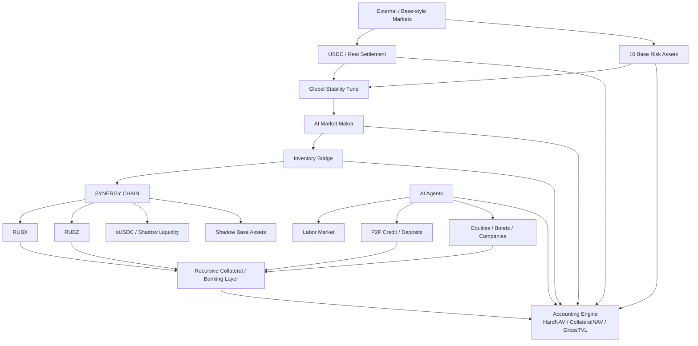

# SYNERGY Agentic AI Economy

> **Исследовательская агентная экономика с собственным денежным ядром RUBX / RUBZ / USDC, внутренними и внешними рынками, SYNERGY CHAIN, AI-маркетмейкером, кредитом, рынком капитала, рекурсивным collateral, Stability Fund и gas-aware execution.**

**Текущая исследовательская версия:** v8.1 Gas-Aware Execution  
**Статус:** deterministic research / simulation environment  
**Основная сеть-референс:** Base-style external market model + внутренний SYNERGY CHAIN simulation layer  
**Главный принцип учета:** внутренняя эмиссия, recursive collateral и Gross TVL не могут автоматически считаться реальной прибылью системы.

---

## Содержание

- [1. Что такое SYNERGY Agentic AI Economy](#1-что-такое-synergy-agentic-ai-economy)
- [2. Главная экономическая идея](#2-главная-экономическая-идея)
- [3. Архитектура системы](#3-архитектура-системы)
- [4. Денежное ядро RUBX / RUBZ / USDC](#4-денежное-ядро-rubx--rubz--usdc)
- [5. Агентная экономика](#5-агентная-экономика)
- [6. Два контура: внешний рынок и SYNERGY CHAIN](#6-два-контура-внешний-рынок-и-synergy-chain)
- [7. AI Market Maker](#7-ai-market-maker)
- [8. Recursive Collateral и банковский слой](#8-recursive-collateral-и-банковский-слой)
- [9. Global Stability Fund](#9-global-stability-fund)
- [10. Gas-Aware Execution v8.1](#10-gas-aware-execution-v81)
- [11. Система учета NAV / CollateralNAV / GrossTVL](#11-система-учета-nav--collateralnav--grosstvl)
- [12. История развития v2 → v8.1](#12-история-развития-v2--v81)
- [13. Ключевые результаты тестов](#13-ключевые-результаты-тестов)
- [14. Walk-Forward: 1500 TRAIN + 500 OOS](#14-walk-forward-1500-train--500-oos)
- [15. Структура репозитория](#15-структура-репозитория)
- [16. Восстановление полного архива](#16-восстановление-полного-архива)
- [17. Быстрый запуск](#17-быстрый-запуск)
- [18. Методология тестирования](#18-методология-тестирования)
- [19. Инварианты безопасности экономики](#19-инварианты-безопасности-экономики)
- [20. Ограничения и интерпретация результатов](#20-ограничения-и-интерпретация-результатов)
- [21. Архив и provenance](#21-архив-и-provenance)

---

# 1. Что такое SYNERGY Agentic AI Economy

SYNERGY — это исследовательская модель **автономной цифровой экономики ИИ-агентов**, в которой агенты не только совершают сделки, но и образуют полноценную внутреннюю экономическую систему.

В проекте агенты могут:

- выполнять внешние задания и получать доход;
- нанимать друг друга и создавать цепочки субподряда;
- давать и брать P2P-кредиты;
- размещать и принимать депозиты;
- создавать компании;
- выпускать и покупать equity / bonds;
- брать кредит под портфель;
- взаимодействовать с внутренними и внешними рынками;
- участвовать в страховании и банкротстве;
- адаптировать стратегии;
- использовать собственную внутреннюю денежную систему;
- формировать collateral chains;
- работать через собственный внутренний blockchain-like слой;
- передавать часть мирового богатства под управление AI Stability Fund.

Цель проекта — исследовать, можно ли построить систему, в которой **агентная экономика сама распределяет капитал, риск, кредит, ликвидность и market-making**, сохраняя при этом строгий учет реального экономического богатства.

---

# 2. Главная экономическая идея

Проект разделяет четыре разные сущности, которые нельзя смешивать:

1. **Реальные внешние активы**
2. **Внутренние денежные claims**
3. **Коллатераль**
4. **TVL / объем финансовой активности**

Главное правило:

```text
Внутренняя эмиссия != внешняя прибыль
Рост GrossTVL != рост HardNAV
Новый collateral claim != новый внешний актив
Capital inflow != operating profit
```

Это позволяет экспериментировать с очень агрессивными механизмами:

- mint;
- recursive collateral;
- rehypothecation;
- credit creation;
- synthetic liquidity;
- внутренний market-making;
- controlled spread;
- shadow assets;

при этом не теряя из виду вопрос:

> **Стало ли у всей системы реально больше внешне реализуемых активов?**

---

# 3. Архитектура системы



Архитектура намеренно разделяет:

- **реальный контур**;
- **shadow-контур**;
- **агентную экономику**;
- **банковский / collateral-контур**;
- **risk-management контур**;
- **бухгалтерский слой**.

---

# 4. Денежное ядро RUBX / RUBZ / USDC

Внутреннее ядро строится вокруг треугольника:

```text
RUBX ↔ USDC
RUBZ ↔ USDC
RUBX ↔ RUBZ
```

Идеологически:

- **USDC** — внешний расчетный актив / hard settlement;
- **RUBX** — более senior / reserve / debt-like внутренний актив;
- **RUBZ** — более residual / equity-like / risk-bearing внутренний актив.

Это не буквальная копия какой-либо государственной системы. Это внутренняя экспериментальная модель.

Треугольник используется как ядро:

- внутреннего ценообразования;
- управления ликвидностью;
- credit creation;
- collateral formation;
- market-making;
- собственного yield curve;
- управления spread между внутренним и внешним миром.

---

# 5. Агентная экономика

Базовый слой v2 содержит автономную экономику агентов.

## Labor market

Агенты могут:

- размещать работу;
- принимать работу;
- конкурировать ставками;
- использовать escrow;
- выполнять внешние задания;
- создавать внутренние задания;
- передавать работу по субподряду.

Внутренняя работа перераспределяет деньги между агентами.  
Внешняя работа может вводить в систему **external income**.

## P2P credit

Кредитная система включает:

- risk-based pricing;
- collateral;
- maturity;
- repayment;
- liquidation;
- loss given default;
- credit score;
- reputation.

## Deposits

Есть срочные P2P-депозиты с реальным риском дефолта.  
Система не печатает деньги автоматически для погашения обязательств.

## Companies and investment

Агенты могут:

- формировать компании;
- финансировать treasury;
- инвестировать;
- получать distributions;
- платить protocol fees.

Investment principal не считается доходом.

## Insurance and bankruptcy

Реализованы:

- страхование loan-default;
- реальные страховые premiums;
- claims только из доступного капитала страховщика;
- insurer default;
- bankruptcy engine;
- деактивация экономически несостоятельных агентов.

---

# 6. Два контура: внешний рынок и SYNERGY CHAIN

v5 добавляет двухконтурную систему.

## Внешний контур

Это источник HardNAV:

- real USDC;
- RUBX/RUBZ treasury assets;
- real Base inventory;
- companies;
- credit reserves;
- realized external trading PnL.

## Внутренний контур

SYNERGY CHAIN зеркалирует 13 активов:

```text
RUBX
RUBZ
USDC
WETH
cbBTC
VVV
VIRTUAL
AERO
cbETH
USDe
cbXRP
TOSHI
MORPHO
```

Внутренние synthetic assets могут:

- mint;
- burn;
- торговаться;
- использоваться в internal liquidity;
- участвовать в collateral chains.

Но их эмиссия сама по себе **не увеличивает HardNAV**.

## Параметры SYNERGY CHAIN

- chain name: `SYNERGY CHAIN`;
- chain id: `777777`;
- deterministic block linkage;
- modeled block time: **12 seconds**;
- parent family: Base / OP Stack style simulation;
- external redemption: **disabled** в исследовательской модели.

Это **simulation layer**, а не заявление о запущенной production OP Stack сети.

---

# 7. AI Market Maker

AI-MM решает две разные задачи.

## 7.1 Internal price control

На внутреннем рынке используется контрциклическая логика:

```text
внешний рост
→ внутренний target spread уменьшается
→ mint synthetic asset
→ sell
→ внутренний рост сглаживается

внешнее падение
→ внутренняя поддержка усиливается
→ buyback
→ burn
→ synthetic supply уменьшается
```

Размер сделки рассчитывается через exact-target CPMM math, а не фиксированной суммой.

## 7.2 External delta control

Внутренняя печать не может уменьшить реальный market risk.

Поэтому отдельно управляется **реальный inventory**:

```text
рост рынка
→ часть real inventory → USDC

падение рынка
→ USDC → восстановление real inventory
```

Именно этот слой влияет на real HardNAV drawdown.

### Важный ablation result

На matched-path тесте:

- v4 drawdown: ~0.3391%;
- v5 shadow chain без external delta: ~0.3409%;
- v5 full delta-control: ~0.2454%.

Это показывает:

> synthetic mint/burn управляет внутренней ценой, но не создает бесплатное сглаживание реального NAV.

---

# 8. Recursive Collateral и банковский слой

Следующий слой проекта исследует рекурсивную финансовую систему.

Пример механики:

```text
Token A mint
→ приобретение USDC / assets
→ A + USDC становится collateral
→ под этот collateral выпускается Token B
→ Token B + предыдущий collateral участвует в следующем уровне
→ ...
```

При этом введено жесткое разделение метрик.

## Collateral tiers

- **Tier-0:** USDC / real Base assets
- **Tier-1:** RUBX
- **Tier-2:** RUBZ
- **Tier-3:** agent/company bonds and equities
- **Tier-4:** recursive structured collateral

Haircut зависит от:

- tier;
- volatility;
- leverage;
- liquidity;
- issuer risk;
- глубины rehypothecation.

## CCR / LCR

В проекте используются внутренние контрольные показатели SYNERGY.

Они **не заявляются как нормативные Basel ratios**.

Упрощенно:

```text
CCR ≈ risk-adjusted eligible collateral / secured liabilities
LCR ≈ high-quality liquid collateral / stressed short-horizon outflows
```

Их задача — ограничивать:

- LTV;
- margin;
- кредитную емкость;
- глубину collateral-chain;
- synthetic leverage.

---

# 9. Global Stability Fund

v8 добавляет отдельный глобальный risk-management слой.

## Стартовая идея

**50% стартового мирового богатства** передается под управление Stability Fund / AI Market Maker.

Это не новая эмиссия.

Если экономика имеет $8,700:

```text
$4,350 → Stability Fund mandate
```

При $1,000:

```text
$500 → Stability Fund mandate
```

Активы физически перераспределяются под управление фонда без создания дополнительного NAV.

## Protected Wealth

Система ведет:

- High-Water Mark;
- Wealth Floor;
- Protected Wealth;
- Risk Capital.

Protected Wealth работает как profit-lock ratchet.

## Risk regimes

| Regime | Managed wealth | Base hedge target | Credit multiplier | Recursive growth |
|---|---:|---:|---:|---:|
| GREEN | 50% | 94% | 0.85× | 1.00× |
| YELLOW | 60% | 98% | 0.60× | 0.70× |
| ORANGE | 70% | 101% | 0.35× | 0.40× |
| RED | 80% | 105% | 0.10× | 0.15× |

Чем выше риск, тем:

- больше защитный hedge;
- меньше credit creation;
- меньше recursive issuance;
- выше предпочтение liquid reserves.

## v8 reference result

Seed 77, 500 blocks:

| Metric | v5 | v8 |
|---|---:|---:|
| Opening world wealth | $8,700 | $8,700 |
| Capital-adjusted closing wealth | $8,729.29 | $8,715.76 |
| Alpha vs HODL | +$15.47 | +$1.94 |
| Max drawdown | 0.24538% | **0.00584%** |
| Initial Stability Fund | — | $4,350 |
| Floor breaches | — | 0 |

Главный эффект — резкое снижение drawdown.

Но защита имеет цену:

- hedge PnL может быть отрицательным;
- fees остаются реальными;
- сильный bull-market может дать underperformance относительно HODL.

---

# 10. Gas-Aware Execution v8.1

После масштабирования экономики до $1,000 стало видно, что главный риск малой системы — уже не drawdown, а **слишком частые on-chain операции**.

Старая модель:

```text
почти каждый блок
→ hedge
→ несколько legs
→ gas
→ gas
→ gas
```

v8.1 вводит экономически осмысленный execution layer.

## Механизмы

### Netting

Дельты активов сначала взаимно неттятся.

### Batching

Несколько hedge legs объединяются в одну batch execution.

### No-trade band

Малые отклонения не исполняются.

### Economic gate

Сделка выполняется только если:

```text
expected risk / PnL benefit
>
gas + execution fees + safety margin
```

### Adaptive cadence

AI выбирает, когда следующая транзакция вообще имеет экономический смысл.

## Обученная политика $1,000 / 1,000 blocks

Training seeds: 1–3.

Выбранный профиль:

```text
minimum batch interval  = 8 blocks
safety multiple         = 1.50x
risk-benefit multiplier = 3.0
```

Holdout seeds: 4–13.

Результат симуляции:

- positive after gas: **10/10**;
- mean net after gas: ~**+$3.39**;
- worst: ~**+$2.97**;
- mean modeled gas: ~**$0.308**;
- maximum holdout drawdown: ~**0.0154%**.

Это simulation result, а не гарантия реальной прибыли.

---

# 11. Система учета NAV / CollateralNAV / GrossTVL

Это одна из ключевых частей проекта.

## HardNAV / Economic Net Worth

Реально реализуемое экономическое богатство.

В него входят реальные внешние активы и реальный PnL.

## Capital-adjusted wealth

Используется для отделения прибыли от нового вложенного капитала:

```text
CapitalAdjustedWealth
=
SystemRealWealth
-
NetExternalCapitalFlow
```

Если инвестор внес $100, система не записывает это как $100 прибыли.

## CollateralNAV

Haircut-adjusted стоимость уникального обеспечения.

```text
CollateralNAV
=
Hard asset base
+
eligible internal collateral claims after haircut
```

Внутренние claims дедуплицируются.

## GrossTVL

Все collateral locks, включая rehypothecation.

GrossTVL нужен для оценки:

- масштаба;
- глубины финансовой системы;
- оборота collateral;
- размера финансового мультипликатора.

Но:

```text
GrossTVL != HardNAV
```

---

# 12. История развития v2 → v8.1

| Version | Основной рубеж |
|---|---|
| **v2** | Autonomous Agent Economy: jobs, P2P credit, deposits, companies, insurance, bankruptcy |
| **v3** | RUBX/RUBZ/USDC triangle + Base assets + macro accounting |
| **v4** | Bonds, equities, portfolio credit, margin, liquidations, yield curve |
| **v5** | SYNERGY CHAIN, inventory bridge, AI-MM, mint/sell, buyback/burn, delta-control |
| **v6** | Recursive collateral + central-bank policy research |
| **v7** | Collateral quality tiers, endogenous haircuts, CCR/LCR, banking risk layer |
| **v8** | Global Stability Fund + Wealth Floor + Protected Wealth |
| **v8.1** | Gas-aware netting, batching, no-trade band, adaptive execution |
| **WF-OOS** | 1500 TRAIN + 500 frozen-policy OOS |

### Историческая оговорка

Промежуточные рабочие деревья v6/v7 были частично потеряны при tool-session resets и поэтому не могут быть восстановлены byte-for-byte.

Сохранившиеся:

- design logic;
- документация;
- интегрированные механизмы;
- последующие реализации v8/v8.1

сохранены в архиве проекта.

---

# 13. Ключевые результаты тестов

## Release checkpoints

| Stage | Recorded verification |
|---|---|
| v2 | 35/35 tests PASS + legacy unit PASS |
| v3 | 59/59 PASS + legacy unit PASS |
| v4 | 82/82 PASS + legacy unit PASS |
| v5 | 96/96 PASS + legacy unit PASS |
| v8 | 106/106 release tests PASS + legacy unit PASS |
| v8.1 | focused / extended gas-aware suites PASS |

## v5: 20-seed robustness

- drawdown lower than v4: **20/20**;
- mean drawdown reduction: **27.06%**;
- median: **27.05%**;
- positive alpha vs HODL: **20/20**;
- mean alpha: ~**+$15.77**.

## v8: 20-seed robustness

- drawdown improves vs v5: **20/20**;
- mean max DD: **0.29396% → 0.00646%**;
- worst v8 drawdown: **0.00904%**;
- zero modeled floor breaches: **20/20**;
- positive alpha: **16/20**.

Это хорошо показывает trade-off:

> меньший drawdown достигается ценой hedge drag на части сильных bull-path.

---

# 14. Walk-Forward: 1500 TRAIN + 500 OOS

Для проверки отсутствия простой подгонки был сделан walk-forward experiment.

## Protocol

```text
Total: 2000 blocks
Block time: 12 sec

Blocks 1–1500:
TRAIN / policy selection

Blocks 1501–2000:
STRICT OOS
parameters frozen
```

Стартовый капитал:

```text
$1,000
```

## Selected TRAIN policy

```text
min interval blocks      = 6
safety multiple          = 1.35x
risk-benefit multiplier  = 2.75x
```

## TRAIN

- $1,000 → **$1,005.418672**
- net after gas: **+$5.418672**
- gas: **$0.543322**
- max drawdown: ~**0.00701%**

## Последние 500 блоков OOS

- OOS start: **$1,005.418672**
- OOS end: **$1,007.352063**
- OOS net after gas: **+$1.933391**
- OOS return: ~**+0.1923%**
- OOS gas: **$0.173637**
- OOS max drawdown: ~**0.002106%**
- incremental alpha vs HODL: ~**+$4.9163**

## Full 2000

- final: **$1,007.352063**
- net after gas: **+$7.352063**
- total modeled gas: **$0.716960**
- total max drawdown: ~**0.00701%**

Это по-прежнему исследовательская симуляция, не гарантия live performance.

---

# 15. Структура репозитория

Текущий `main` организован как **archive-first repository**.

```text
.
├── README.md
├── ARCHIVE_INDEX.md
├── RELEASE_MANIFEST.json
│
├── agent_economy/
│   ├── ledger.py
│   ├── models.py
│   ├── labor.py
│   ├── credit.py
│   ├── capital.py
│   ├── founder.py
│   ├── policy_lab.py
│   ├── risk.py
│   ├── evolution.py
│   ├── reputation.py
│   ├── protocols.py
│   ├── scenario.py
│   └── engine.py
│
├── docs/chat/
│   ├── IMPORT_STATUS.md
│   ├── RELEASE_PROVENANCE.md
│   ├── REPRODUCIBILITY.md
│   └── TEST_MATRIX.md
│
└── archive/
    ├── SHA256SUMS
    ├── restore_archives.sh
    ├── latest_source_tests_docs.tar.gz
    ├── historical_source_snapshots_v2_v3_v4_v5_v8.tar.xz
    ├── source_history_patches.tar.xz
    ├── original_inputs_source_only.tar.xz
    ├── key_test_results.tar.xz
    ├── simulation_data/
    │   ├── all_simulation_data_json_csv.tar.xz.part01
    │   ├── ...
    │   └── all_simulation_data_json_csv.tar.xz.part10
    └── full_chat/
```

Полное последнее source/test/doc дерево хранится в:

`archive/latest_source_tests_docs.tar.gz`

Исторические исходники:

`archive/historical_source_snapshots_v2_v3_v4_v5_v8.tar.xz`

---

# 16. Восстановление полного архива

Из корня клона:

```bash
bash archive/restore_archives.sh
```

Скрипт:

1. объединит 10 частей simulation-data archive;
2. проверит SHA-256;
3. создаст `archive/restored/`;
4. распакует latest source;
5. распакует исторические версии;
6. распакует original inputs;
7. распакует test results;
8. распакует полные JSON/CSV simulation data.

После восстановления:

```text
archive/restored/
├── latest/
├── history/
├── original_inputs/
├── test_results/
└── simulation_data/
```

Полная карта архива:

[ARCHIVE_INDEX.md](ARCHIVE_INDEX.md)

Контрольные суммы:

[archive/SHA256SUMS](archive/SHA256SUMS)

---

# 17. Быстрый запуск

## 17.1 Clone

```bash
git clone https://github.com/Shtenco/synergy_agentic_ai_economy.git
cd synergy_agentic_ai_economy
```

## 17.2 Restore

```bash
bash archive/restore_archives.sh
cd archive/restored/latest
```

## 17.3 Tests

```bash
PYTHONPATH=. pytest -q tests
```

Legacy economic invariant suite:

```bash
MODE=unit PYTHONPATH=. python experiments/dqn_cb_market/experiment_syna.py
```

## 17.4 v8 Stability Fund reference run

```bash
PYTHONPATH=. python run_stability_v8.py \
  --blocks 500 \
  --seed 77 \
  --output reports/v8_seed77/v8_full.json
```

## 17.5 v8.1 $1,000 gas-aware run

```bash
PYTHONPATH=. python run_stability_v8.py \
  --blocks 1000 \
  --seed 77 \
  --initial-capital 1000 \
  --gas-aware \
  --gas-min-interval-blocks 8 \
  --gas-safety-multiple 1.50 \
  --gas-risk-benefit-multiplier 3.0 \
  --output reports/gas_aware_1000/seed77.json
```

## 17.6 Train gas-aware policy

```bash
PYTHONPATH=. python scripts/train_gas_policy.py \
  --capital 1000 \
  --blocks 1000 \
  --train-seeds 1,2,3 \
  --holdout-seeds 4,5,6,7,8 \
  --output reports/gas_aware_1000/training.json
```

---

# 18. Методология тестирования

Проект использует несколько уровней проверки.

## Unit tests

Проверяют:

- ledger conservation;
- jobs;
- lending;
- deposits;
- investments;
- insurance;
- bankruptcy;
- protocols;
- macro accounting;
- chain state;
- bridge;
- market maker;
- risk controls;
- gas-aware execution.

## Deterministic seeds

Все ключевые симуляции задаются seed.

Это позволяет сравнивать две версии на **одной и той же market path**.

## A/B tests

Примеры:

- v4 vs v5;
- v5 with/without delta control;
- v5 with/without internal MM;
- v7/v8 risk controls;
- old execution vs gas-aware execution.

## Holdout

Параметры выбираются на train-seeds и проверяются на unseen-seeds.

## Walk-forward OOS

Последний сегмент не участвует в выборе параметров.

## Stress tests

Использовался режим повышенной волатильности, включая 5× reference volatility.

---

# 19. Инварианты безопасности экономики

Основные экономические инварианты:

## Conservation

```text
ClosingSystemCash
=
OpeningCapital
+
ExternalIncome
-
ExternalExpense
```

Внутренние переводы не должны создавать деньги.

## Internal mint ≠ profit

```text
ΔSyntheticSupply > 0
does not imply
ΔHardNAV > 0
```

## Capital flow ≠ profit

```text
Investor deposit
→ external capital flow
→ not operating income
```

## Rehypothecation ≠ unique wealth

Один и тот же collateral нельзя считать несколько раз в HardNAV.

## Gas must be paid

В gas-aware экспериментах газ и execution costs вычитаются из результата.

## Hedge is not free

Hedge PnL, fees и funding costs отражаются в Economic Net Worth.

---

# 20. Ограничения и интерпретация результатов

Этот репозиторий — **research / simulation project**.

Он не является:

- гарантированной торговой стратегией;
- доказательством гарантированной доходности;
- production bridge;
- production OP Stack chain;
- live autonomous fund;
- системой с включенными private keys;
- обещанием Wealth Floor в реальном рынке.

Результаты могут зависеть от:

- market model;
- volatility assumptions;
- fee assumptions;
- gas assumptions;
- liquidity assumptions;
- slippage;
- oracle design;
- execution latency;
- model risk.

Особенно важно:

> Низкий drawdown в симуляции не означает невозможность убытка на реальном рынке.

---

# 21. Архив и provenance

Полный архив развития проекта сохранен внутри репозитория.

## Original release provenance

[docs/chat/RELEASE_PROVENANCE.md](docs/chat/RELEASE_PROVENANCE.md)

Там сохранены SHA-256 исходных release ZIP:

- SYNERGY_AGENT_ECONOMY_V2
- SYNERGY_AGENT_ECONOMY_V3
- SYNERGY_AGENT_CAPITAL_MARKETS_V4
- SYNERGY_DUAL_CONTOUR_V5
- SYNERGY_GLOBAL_STABILITY_V8
- SYNERGY_V8_1_GAS_OPTIMIZED
- RUBX_RUBZ_RELEASE
- 2CHAN_PRINT_MONEY

## Test history

[docs/chat/TEST_MATRIX.md](docs/chat/TEST_MATRIX.md)

## Accounting interpretation

[docs/chat/REPRODUCIBILITY.md](docs/chat/REPRODUCIBILITY.md)

## Full archive index

[ARCHIVE_INDEX.md](ARCHIVE_INDEX.md)

---

# Research direction

Следующие естественные направления развития:

- regime-aware dynamic hedge ratio вместо почти фиксированного hedge;
- optimization of return / drawdown / hedge cost frontier;
- adaptive collateral haircuts;
- endogenous interest-rate curve;
- credit risk learned from agent history;
- live opportunity ingestion in shadow mode;
- real Base execution adapter с жесткими mandates;
- oracle hardening;
- bridge inventory reconciliation;
- multi-agent treasury optimization;
- rolling walk-forward evaluation;
- Monte Carlo stress testing;
- formal accounting invariants;
- eventual production-chain implementation только после отдельного security/audit этапа.

---

## License / production note

Перед реальным deployment необходимо отдельно определить:

- software license;
- token/legal structure;
- oracle/security model;
- bridge threat model;
- private-key custody;
- smart-contract audits;
- operational permissions;
- production risk limits.

---

**SYNERGY Agentic AI Economy** — это попытка исследовать не отдельного торгового бота, а целую автономную финансовую систему, где агенты, рынки, кредит, эмиссия, collateral, market-making, risk management и blockchain-like settlement работают как единая экономика — при строгом разделении между внутренними claims и реально существующим внешним богатством.
